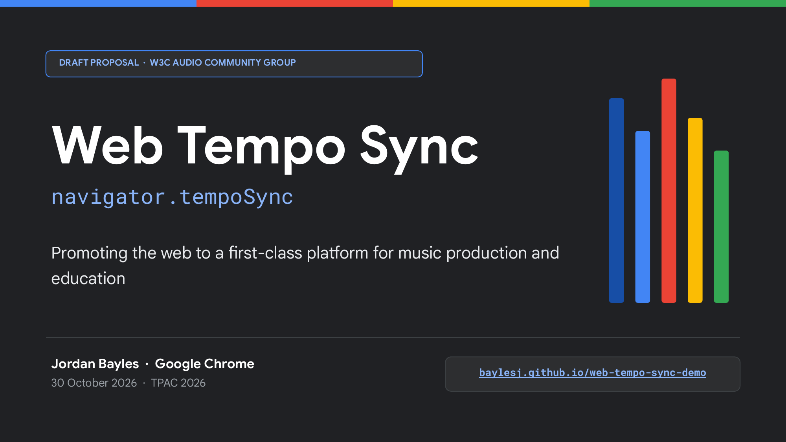
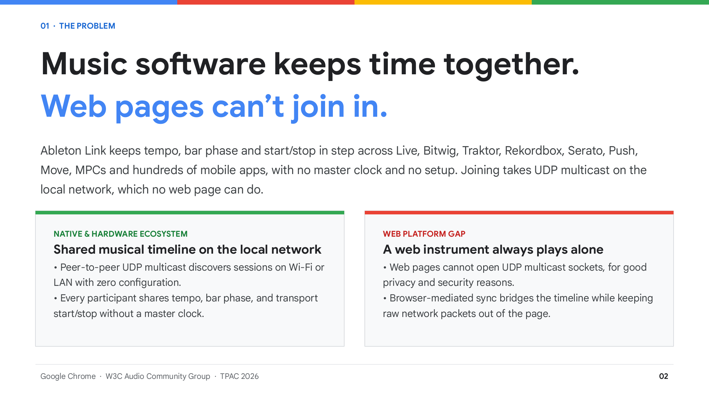
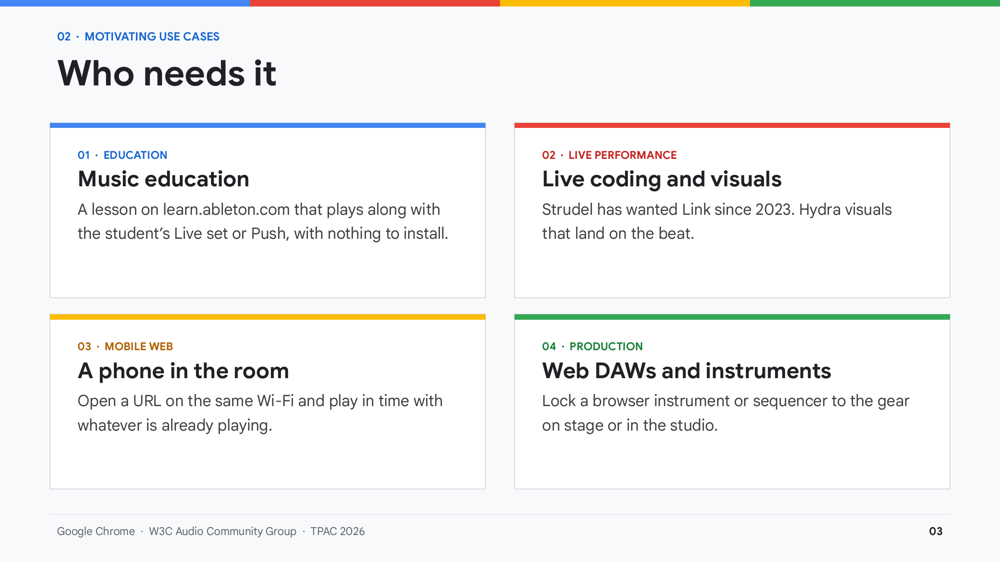
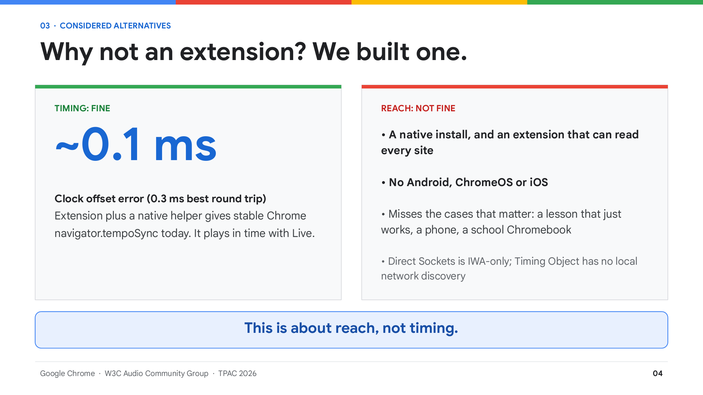
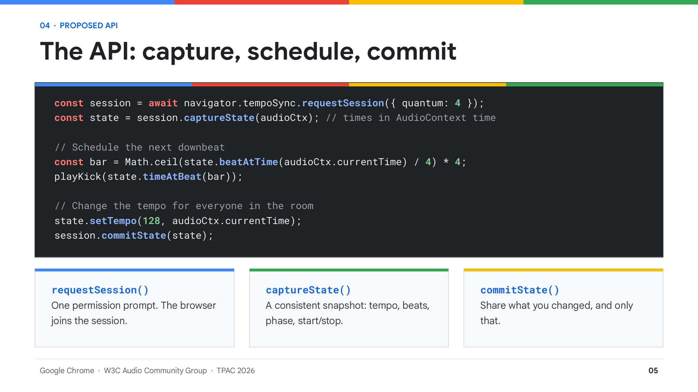
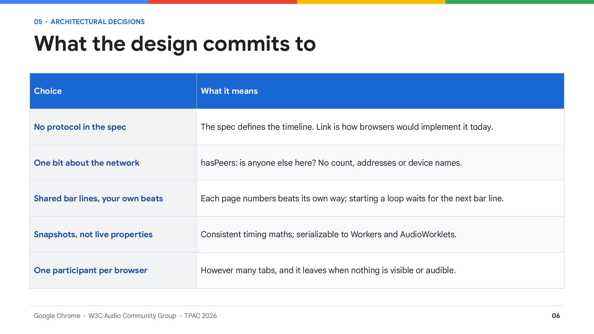
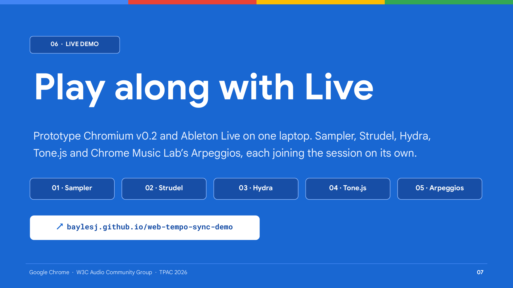
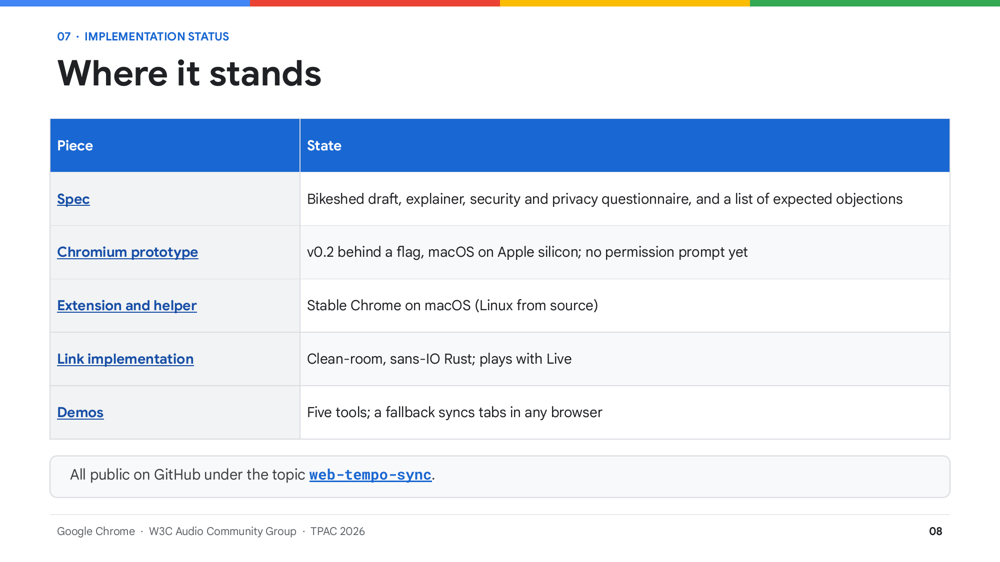
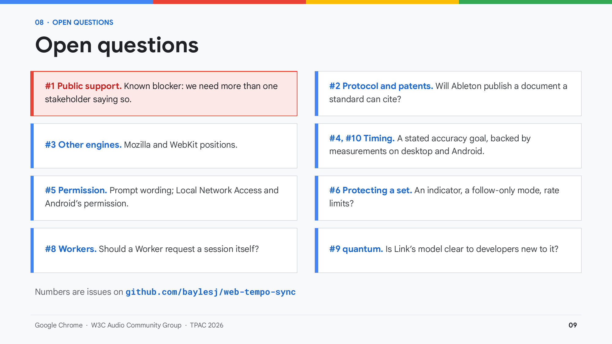
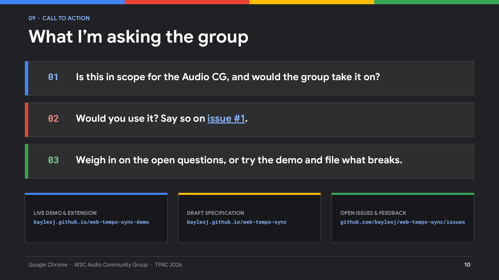

# Slides: W3C Audio Community Group (TPAC 2026)

10-minute presentation and live demo for the W3C Audio Community Group at TPAC 2026 (30 October 2026).

* **Download**: [PDF](slides/web-tempo-sync-tpac-2026.pdf) · [PowerPoint (.pptx)](slides/web-tempo-sync-tpac-2026.pptx) · [Google Slides](https://docs.google.com/presentation/d/1OjVssmxwtGPKzwPL4sRhRMNaq9gzNHt8UJW00j3wA0k/edit?usp=sharing)
* **Live demo**: [baylesj.github.io/web-tempo-sync-demo](https://baylesj.github.io/web-tempo-sync-demo/) · [Demo script (`DEMO-SCRIPT.md`)](https://github.com/baylesj/web-tempo-sync-demo/blob/main/DEMO-SCRIPT.md)

---

## 1. Web Tempo Sync (`navigator.tempoSync`)

> Hi, I’m Jordan Bayles, on the Chrome team at Google. This is a draft proposal I’d like the Audio CG’s feedback on: a small API that lets a web page join the shared musical timeline that DAWs, DJ software and hardware already share on a local network. About ten minutes, with a live demo in the middle. Everything is public: the link at the bottom right has the demos, the spec, and the issues.

---

## 2. The problem

> Outside the browser this is a solved problem. Link is everywhere: DAWs, DJ software, grooveboxes, phone apps. You turn it on and everything plays in time, with no master and no configuration. A web page can’t take part, because joining means sending and receiving UDP multicast on the local network, and we don’t give pages that, for good reasons. So a web instrument always plays alone.

---

## 3. Who needs it

> The motivating case is education. Ableton’s Learning Music and Learning Synths sites teach in the browser; a lesson that plays in time with your own Live set turns an exercise into playing along, and it has to work with nothing installed. Live coding is the second community, with a documented need: Strudel’s Link request dates from 2023, with two closed attempts. Then the phone in the room, and web DAWs and instruments.

---

## 4. Why not an extension? We built one.

> The first question is always “why can’t this be an extension or a helper app?” So we built that. Its timing error is about a tenth of a millisecond: the clock-offset estimate has a best round trip of 0.3 ms. Timing isn’t the problem. Reach is: it needs a native install and a broadly-permissioned extension, and it can’t run on Android, ChromeOS or iOS, which are exactly the learners and phones this is for. The same answer covers Direct Sockets: only in Isolated Web Apps.

---

## 5. The API: capture, schedule, commit

> The whole API fits on a slide. `requestSession` asks for permission once and joins. `captureState` gives you a snapshot of the timeline; pass your `AudioContext` and every time in it is in that clock, so you schedule with Web Audio as usual. To change something, edit the snapshot and commit it. The browser does the networking and clock sync; the page never touches the network.

---

## 6. What the design commits to

> Five choices worth calling out. The spec doesn’t name a protocol; Link lives in the explainer. Pages learn one bit about the network. Beat numbering is per page, as in Link, so a page starting its loop never moves anyone else’s bar lines. Snapshots avoid torn reads and can be posted to a worklet. And the browser is one participant however many tabs are open, so other devices can’t count your tabs.

---

## 7. Live demo: Play along with Live

> Switch to the browser now. Follow the [demo script](https://github.com/baylesj/web-tempo-sync-demo/blob/main/DEMO-SCRIPT.md) (`DEMO-SCRIPT.md` in the demo repo). If the live demo fails, play the backup recording.

---

## 8. Where it stands

> Where things are. The spec is a Bikeshed draft with an explainer, the security and privacy questionnaire, and a document of the objections we expect with our answers. There’s a Chromium prototype, now at v0.2, an extension for stable Chrome, a clean-room Rust implementation of Link, and the demo site. All of it is public.

---

## 9. Open questions

> These are the open questions, each filed as an [issue on the spec repo](https://github.com/baylesj/web-tempo-sync/issues). The first is the one I most need this group for: the proposal needs more than one stakeholder saying in public that they want it. The rest are design questions where the group’s experience with Web Audio and Web MIDI would help, especially timing and Workers.

---

## 10. What I’m asking the group

> Three asks. First, is this in scope for the Audio CG, and would the group take it on as a work item? Second, if you or your project would use this, please say so on [issue #1](https://github.com/baylesj/web-tempo-sync/issues/1); that’s the known blocker. Third, the open questions are all issues; comments and bug reports from the demo are very welcome. Thanks, and questions.
